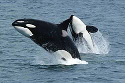

# La Orca: El Superdepredador de los Océanos

## Introducción
La orca (*Orcinus orca*) es una especie de cetáceo odontoceto perteneciente a la familia Delphinidae, siendo los miembros de mayor tamaño de este grupo. Se distribuyen por todos los océanos del planeta, desde las frías regiones árticas y antárticas hasta los mares tropicales cálidos. A menudo se les conoce erróneamente como "ballenas asesinas", pero en realidad son los delfines más grandes que existen.

Estos mamíferos marinos poseen una apariencia sumamente distintiva, caracterizada por un dorso negro purpúreo y un pecho y laterales blancos. Su cuerpo es robusto, hidrodinámico y cuentan con una gran aleta dorsal que puede alcanzar hasta 1,8 metros de altura en los machos adultos. Además, muestran un marcado dimorfismo sexual; los machos son notablemente más grandes y pesados que las hembras.

Las orcas son animales altamente sociales que viven en estructuras familiares matriarcales complejas y estables. Cada grupo posee dialectos vocales únicos y técnicas de caza específicas que se transmiten de generación en generación. Su inteligencia, adaptabilidad y complejas interacciones sociales las convierten en uno de los seres vivos más fascinantes del mundo marino.

## Historia y Evolución
1. Sus ancestros eran mamíferos terrestres que comenzaron a adaptarse a la vida marina hace unos 50 millones de años.
2. La familia de los delfínidos (a la que pertenecen) divergió y se expandió rápidamente durante el Mioceno.
3. El género *Orcinus* apareció en el registro fósil hace varios millones de años, consolidándose como cazadores especializados.

## Importancia en el Ecosistema
Como superdepredadores en la cima de la cadena alimenticia marina, las orcas no tienen enemigos naturales. Su presencia ayuda de las siguientes maneras:
- Regulan las poblaciones de otras especies marinas, como focas, leones marinos y peces.
- Evitan la sobrepoblación de presas, lo que previene el agotamiento de los recursos locales.
- Sirven como indicadores de la salud del ecosistema oceánico general.

Puedes encontrar más información detallada sobre su biología en [Wikipedia](https://es.wikipedia.org/wiki/Orcinus_orca).

## Conclusión
La orca es una obra maestra de la evolución marina, demostrando que la fuerza bruta es secundaria a la inteligencia cooperativa y la estructura social organizada. Proteger a estas criaturas y a sus hábitats es fundamental para garantizar el equilibrio biológico de nuestros océanos y el bienestar de los ecosistemas globales.
